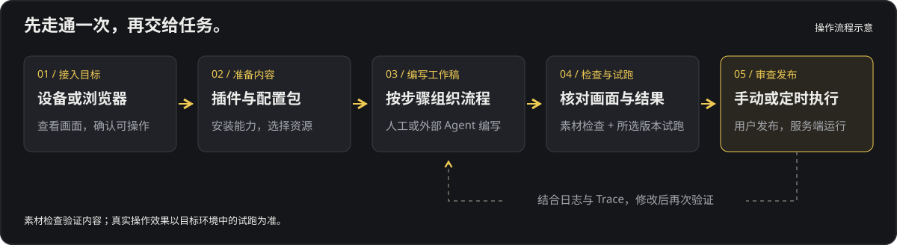

# Gamer 官方插件

为 [Gamer](https://github.com/jesongit/gamer) 提供自动化、按键映射、操作素材、通知与直播等能力。插件的功能介绍、使用示例、构建和开发说明统一在本仓库维护。

**[下载插件](https://github.com/jesongit/gamer-plugins/releases/latest)** · [发行说明](RELEASE_NOTES.md) · [Gamer 文档](https://jesongit.github.io/gamer/) · [反馈问题](https://github.com/jesongit/gamer-plugins/issues)

## 选择插件

| 插件 | 功能 | 当前源码版本 | 使用说明 |
| --- | --- | --- | --- |
| `gamer-yaml` 自动化 | YAML 脚本、函数、模板、工作稿版本、检查与执行 | `0.3.26` | [自动化](gamer-yaml/README.md) |
| `gamer-keymap` 按键映射 | 将键盘、鼠标与手柄动作映射为目标输入 | `0.1.7` | [按键映射](gamer-keymap/README.md) |
| `gamer-video` 视频工作台 | 录制、逐帧分析、目标标记与独立素材包 | `0.2.7` | [视频工作台](gamer-video/README.md) |
| `gamer-notify` 通知助手 | 通知渠道、任务结果通知与发送记录 | `0.1.2` | [通知助手](gamer-notify/README.md) |
| `gamer-live` 直播助手 | 设备与媒体输出、推流和互动队列 | `0.2.19` | [直播助手](gamer-live/README.md) |
| `gamer-package-publisher` 配置包发布 | 通过服务电脑上的 GitHub CLI 发布配置包 | `0.1.0` | [配置包发布](gamer-package-publisher/README.md) |

源码版本与已公开目录分别管理，实际可安装版本以 Release 和界面目录为准。视频工作台 `0.2.7` 和键盘映射 `0.1.7` 要求 Gamer `0.5.8` 或更新版本；自动化 `0.3.26` 和直播助手 `0.2.19` 要求 Gamer `0.5.2` 或更新版本；其他插件以各自 manifest 的宿主版本要求为准。

OCR 已内置 Gamer Core，在「设置 → 运行依赖」管理识别引擎与语言模型，无需安装独立插件。[OCR 指南](https://github.com/jesongit/gamer/blob/main/docs/guides/ocr.md)说明使用方式。历史 `gamer-ocr`、`gamer-ai` 安装与私密数据保留，但不参与当前构建和分发；模型、对话与规划由用户选择的外部 Agent 承担。

## 安装与使用

1. 在 Gamer「插件」页检查名称、来源、权限和宿主版本要求，再安装需要的功能；也可以导入 Release 中的 `.gplugin`。
2. 保存编辑内容后刷新页面，加载新安装或更新的界面。插件面板随启用状态与适用目标变化。
3. 在工作台选择目标与配置包。配置包组织业务资源，插件提供能力；两者分别安装和管理，首次安装不预置游戏脚本。

插件页发现最新公开目录，稳定宿主过滤预发布；网络失败时回退缓存和随包目录。下载使用不可变地址并校验大小与 SHA256，安装和权限扩展由用户确认，不自动替换用户安装。完整便携包的首装目录由 Gamer 发行锁指定。

## 从画面到自动化



先用视频工作台录制操作，逐帧标记目标并提取模板，也可以直接准备截图和模板。随后人工编辑 YAML，或让自己的外部 Agent 通过 Gamer MCP 保存工作稿。工作稿按版本保留，检查后明确试跑所选版本，审查通过再由用户发布。素材检查不操作设备，真实效果需在目标环境试跑确认。

### 一个脚本示例

在当前配置包准备 `reward.png` 与 `confirm.png`，等待奖励按钮、点击，并在确认弹窗出现时处理它：

```yaml
name: 领取奖励
targets:
  reward: {template: reward.png}
  confirm: {template: confirm.png}
run:
  - wait: reward
    timeout: 10s
    as: button
    then:
      - tap: $button
  - optional:
      find: confirm
      timeout: 0ms
      as: popup
      then:
        - tap: $popup
  - log: 奖励流程完成
```

`wait` 只观察，点击由 `tap` 显式执行。所有步骤无异常执行完即成功，任一步报错即失败；需要确认游戏状态时，在对应位置加入视觉检查。YAML 不使用语法版本字段，正式脚本独立运行，无需模型或 Agent 在线。

[YAML 教程](https://github.com/jesongit/gamer/blob/main/docs/guides/yaml-tutorial.md) · [权威语法参考](https://github.com/jesongit/gamer/blob/main/docs/reference/YAML.md) · [工作稿与版本](https://github.com/jesongit/gamer/blob/main/docs/guides/ai-automation-tutorial.md) · [Runtime Trace](https://github.com/jesongit/gamer/blob/main/docs/reference/RUNTIME_TRACE.md)

## 外部 Agent

统一 MCP 由 Gamer Core 提供，插件通过 manifest 中显式的 `[[tools]]` 和随包 JSON schema 接入。工具的可见性取决于插件运行状态、权限与令牌授权范围，不自动开放管理 action、界面按钮或原生函数。

键盘映射提供 `grammar` 读取语法及可验证示例，再通过 `profiles_validate` / `profiles_write` 保存方案；视频 `sample_list` 支持按显示名称搜索。两者均需包含相应 host 实现的新宿主，单独更新插件归档不能替换原生代码。

通知、推流、凭据配置和正式发布不能借普通脚本工具间接获得。输入继续服从 Core 控制租约、暂停屏障与帧身份校验。接入见 [MCP 指南](https://github.com/jesongit/gamer/blob/main/docs/guides/external-agent-mcp.md)。

## 独立构建与开发

准备 Rust stable、`wasm32-unknown-unknown`、Node.js 24、各 UI `packageManager` 指定的 pnpm 和 PowerShell 7，在本仓库根目录执行：

```powershell
./build.ps1 -ChecksumsFile "$PWD/dist/sha256sums.txt"
# 只构建一个插件
./gamer-yaml/build.ps1
```

构建不要求相邻的 Gamer 工作区，产物写入 `dist/`。每个插件保存自己的 manifest、host、UI、测试和使用说明；WASM 插件另含 guest。普通 Gamer 前端构建只构建壳，插件 UI 单独构建和打包。已安装界面来自归档，修改后需更新归档并刷新页面。

`sdk/lock.json` 固定 SDK 来源提交与逐文件 SHA256，构建前校验。正式发布须使用已提交的宿主快照，不能把 working-tree 快照冒充发布基线。更新快照使用 Gamer 的 `tools/export-plugin-sdk.ps1`，接口变更后同步验证宿主。

`host/` 适配代码和 builtin 服务仍随 Gamer 编译，变更时需要发布本体。WASM 与 UI 可在现有 SDK/ABI 和声明的宿主版本范围内独立更新。第三方开发入口见 [Host API 与开发指南](https://github.com/jesongit/gamer/blob/main/docs/guides/plugin-dev.md)。

## 检查与联调

```powershell
node tools/verify-sdk.mjs
node --test tools/release.test.mjs
cargo test --locked --manifest-path gamer-yaml/interpreter/Cargo.toml
```

集成 CI 显式检出 SDK 锁定的 Gamer 来源，再将本次插件提交放入宿主的 `plugins/`，测试该提交产生的真实归档、前端与宿主。主仓通过固定 gitlink 引用本仓，不跟随远端最新分支。按键映射 UI 当前无独立测试文件，不能计为覆盖。

## 发布与数据保留

推送 `<plugin-id>-v<manifest-version>` 标签会运行独立构建和固定宿主集成测试，成功后创建 Release 草稿。每次发布包含同一基线核验的六款插件及版本化 `registry.json`，各插件版本互不绑定。复核下载后的归档、哈希与目录后再公开。

历史标签和资产不可覆盖。未变更版本在 `release-reuse.lock.json` 固定旧归档来源，逐 ZIP 条目比较一致后复用原公开字节；内容变化必须递增版本。发布顺序为插件提交与 Release 在先，再更新 Gamer 的 gitlink 和发行锁。

配置包、脚本、模板、独立素材、工作稿全部版本、发布记录和用户凭据分别保存。插件更新不清理历史安装或退休插件私密数据。源码迁移前历史保留在 [Gamer 主仓](https://github.com/jesongit/gamer)，当前各插件用法见上方清单。
